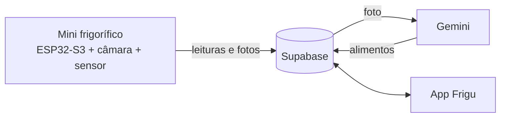

# Frigu

App Android em Flutter para um mini frigorífico inteligente, feita no âmbito do Projeto Interdisciplinar 2 (PI2) do CTeSP em Design e Tecnologias para Aplicações Móveis, na ESMAD (P.Porto), em 2026/2027.

Estado: em desenvolvimento. A entrega final é em janeiro de 2027.

## Sobre o projeto

Muita comida vai para o lixo porque fica esquecida no frigorífico até passar de validade. A ideia do Frigu é o frigorífico saber o que tem lá dentro e avisar a tempo.

O frigorífico tem uma câmara que tira uma foto sempre que a porta fecha. A foto é analisada pelo Gemini, que identifica os alimentos e atualiza o inventário. Com isso, a app consegue:

- mostrar o que está no frigorífico e as validades
- avisar 2 dias antes de um alimento expirar
- sugerir receitas com o que já existe, começando pelo que expira primeiro
- mostrar a temperatura e a humidade, e avisar se a porta ficar aberta ou a temperatura subir
- mostrar quanto desperdício foi evitado
- fazer a lista de compras a partir do que falta

O projeto está ligado ao ODS 12 (Produção e consumo sustentáveis), mais concretamente à meta 12.3, que é reduzir o desperdício alimentar.

## Como funciona



O protótipo é um mini frigorífico impresso em 3D, arrefecido com gelo e controlado por uma ESP32-S3 com câmara e um sensor de temperatura e humidade. A placa envia as leituras e as fotos para o Supabase, e a app lê os dados a partir daí.

## Ecrãs

| Ecrã | O que mostra | Estado |
|---|---|---|
| Início | Estado do frigorífico, gráfico de temperatura e receita do dia | Em curso |
| Inventário | Alimentos e validades | Por fazer |
| Receitas | Sugestões com os alimentos disponíveis | Por fazer |
| Impacto | Desperdício evitado | Por fazer |
| Compras | Lista de compras | Por fazer |
| Admin | Gestão de receitas e validades (só administradores) | Por fazer |

## Tecnologias

- Flutter e Dart
- Material 3, com cores e tipografia do nosso Figma (fonte Montserrat)
- fl_chart para os gráficos
- Mais tarde: Supabase para os dados e a ESP32-S3 do frigorífico

## Como correr

É preciso ter o [Flutter](https://docs.flutter.dev/get-started/install) instalado.

```bash
git clone https://github.com/vitorwlm/app.git
cd app
flutter pub get
flutter run
```

## Estrutura

```
lib/
├── main.dart     # arranque e barra de navegação
├── screens/      # um ficheiro por ecrã
├── theme/        # cores, letras e tema
├── widgets/      # cartões e botões reutilizáveis
└── services/     # ligação aos dados (ainda vazio)
assets/fonts/     # Montserrat
```

## Equipa

- Vítor: hardware, API, app e relatório
- Nuno: UX, apoio ao hardware, app e relatório
