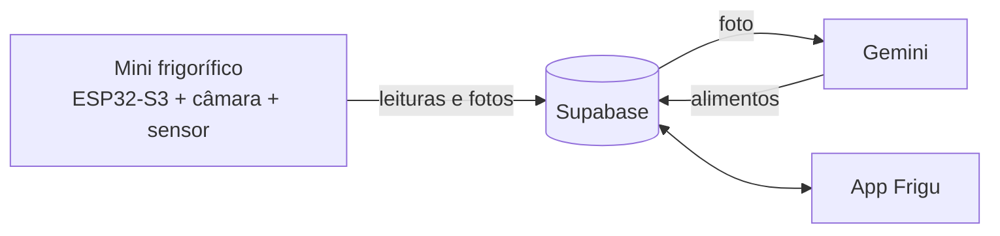

# Frigu

App Android em Flutter para um mini frigorífico inteligente, feita no âmbito do Projeto Interdisciplinar 2 (PI2) do CTeSP em Design e Tecnologias para Aplicações Móveis, na FMAD (P.Porto), em 2026/2027.

Estado: em desenvolvimento. A entrega final é em janeiro de 2027.

## Sobre o projeto

Muita comida vai para o lixo porque fica esquecida no frigorífico até passar de validade. A ideia do Frigu é o frigorífico saber o que tem lá dentro e avisar a tempo.

O frigorífico tem uma câmara que tira uma foto sempre que a porta fecha. A foto é analisada pelo Gemini, que identifica os alimentos e atualiza o inventário. Com isso, a app consegue:

- mostrar o que está no frigorífico e as validades
- avisar 2 dias antes de um alimento expirar
- sugerir receitas com o que já existe, começando pelo que expira primeiro
- mostrar a temperatura e a humidade, e avisar se a porta ficar aberta ou a temperatura subir
- mostrar quanto desperdício foi evitado
- fazer a lista de compras a partir do que falta

O projeto está ligado ao ODS 12 (Produção e consumo sustentáveis), mais concretamente à meta 12.3, que é reduzir o desperdício alimentar.

## Como funciona



O protótipo é um mini frigorífico impresso em 3D, arrefecido com gelo e controlado por uma ESP32-S3 com câmara e um sensor de temperatura e humidade. A placa envia as leituras e as fotos para o Supabase, e a app lê os dados a partir daí.

## Ecrãs

| Ecrã | O que mostra | Estado |
|---|---|---|
| Login | Entrar e criar conta (Supabase Auth) | Feito |
| Início | Estado do frigorífico, a expirar e receita do dia | Feito |
| Temperatura | Histórico de 24 h / 7 dias e aberturas da porta | Feito (à espera das leituras da placa) |
| Inventário | Alimentos e validades, filtros, deslizar para usar | Feito |
| Receitas | Sugestões com os alimentos disponíveis | Feito |
| Impacto | Desperdício evitado (kg, €, CO₂e) | Feito (histórico ainda de exemplo) |
| Compras | Lista de compras partilhada | Feito |
| Avisos e Definições | Alimentos a expirar, temperatura-alvo, conta | Feito |
| Administração | Receitas e validades por categoria (só administradores) | Feito |
| Foto da câmara | Foto analisada pelo Gemini | Por fazer |

## Tecnologias

- Flutter e Dart
- Material 3, com cores e tipografia do nosso Figma (fonte Montserrat)
- fl_chart para os gráficos, share_plus para partilhar a lista
- Supabase: Auth, base de dados com RLS, Realtime e Edge Function com o Gemini
- ESP32-S3 com câmara no frigorífico (por ligar)

## Como correr

É preciso ter o [Flutter](https://docs.flutter.dev/get-started/install) instalado.

```bash
git clone https://github.com/vitorwlm/app.git
cd app
flutter pub get
flutter run
```

Antes de correr, copia `lib/config/secrets.example.dart` para `lib/config/secrets.dart` e põe o URL e a chave publishable do Supabase. Os testes correm com `flutter test`.

## Estrutura

```
lib/
├── main.dart     # arranque, login e barra de navegação
├── config/       # chaves do Supabase (secrets.dart fica fora do Git)
├── data/         # frigorifico.dart: os dados partilhados por todos os ecrãs
├── models/       # Item, Receita, Compra, Evento
├── screens/      # um ficheiro por ecrã
├── services/     # nuvem.dart: ligação ao Supabase
├── theme/        # cores, letras e tema
└── widgets/      # cartões e botões reutilizáveis
test/             # testes unitários
assets/fonts/     # Montserrat
```

## Equipa

- Vítor: hardware, API, app e relatório
- Nuno: UX, apoio ao hardware, app e relatório
