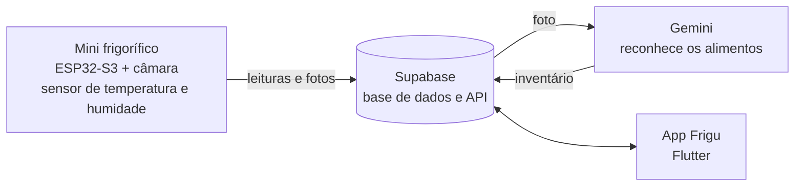

# Frigu — Frigorífico Inteligente

**Frigu** é uma app Android, feita em Flutter, ligada a um mini frigorífico inteligente. O frigorífico tem uma câmara e sensores e sabe sempre o que está lá dentro e em que condições. A app mostra o inventário, avisa antes de os alimentos passarem de validade e sugere receitas com o que já existe. O objetivo é deitar menos comida fora.

## O problema

Uma parte importante da comida comprada acaba no lixo, muitas vezes porque fica esquecida no fundo do frigorífico até passar de validade. É difícil saber o que há em casa quando se está no supermercado, e quase ninguém regista as validades.

## A solução

| | |
|---|---|
| 📷 **Inventário automático** | Quando a porta fecha, a câmara tira uma foto. Um modelo de visão (Gemini) reconhece os alimentos e atualiza o inventário sozinho. |
| ⏰ **Alertas de validade** | Avisa 2 dias antes de um alimento expirar. |
| 🍳 **Receitas** | Sugere receitas com o que já está no frigorífico, dando prioridade ao que expira primeiro. |
| 🌡️ **Monitorização** | Temperatura e humidade em tempo real, com gráficos e alertas de porta aberta ou temperatura alta. |
| 🌱 **Impacto** | Mostra o desperdício evitado ao longo do tempo. |
| 🛒 **Lista de compras** | Feita a partir do que falta, para não comprar a mais. |

## Como funciona



O protótipo é um mini frigorífico impresso em 3D, arrefecido com gelo e controlado por uma ESP32-S3 com câmara. A placa envia as leituras dos sensores e as fotos para o Supabase. A app lê os mesmos dados para mostrar tudo ao utilizador.

## Contexto académico

Projeto Interdisciplinar 2 (PI2) do CTeSP em Design e Tecnologias para Aplicações Móveis — ESMAD, Politécnico do Porto, 2026/2027.

Alinhado com o **ODS 12 — Produção e consumo sustentáveis**, em particular a meta **12.3**: reduzir para metade o desperdício alimentar por pessoa.

> 🚧 Em desenvolvimento. Entrega final: janeiro de 2027.

## Estado dos ecrãs

| Ecrã | Descrição | Estado |
|---|---|---|
| Início | Estado do frigorífico, gráfico de temperatura e receita do dia | Em curso |
| Inventário | Alimentos no frigorífico e respetivas validades | Planeado |
| Receitas | Sugestões com os alimentos disponíveis | Planeado |
| Impacto | Desperdício evitado | Planeado |
| Compras | Lista de compras | Planeado |
| Admin | Gestão de receitas e validades (só administradores) | Planeado |

## Tecnologias

- [Flutter](https://flutter.dev) e Dart
- Material 3 com tema próprio (paleta e tipografia do Figma, fonte Montserrat)
- [fl_chart](https://pub.dev/packages/fl_chart) para gráficos
- Planeado: Supabase (dados) e ESP32-S3 com câmara (hardware do frigorífico)

## Como correr

Requisitos: [Flutter SDK](https://docs.flutter.dev/get-started/install) instalado (`flutter doctor` sem erros).

```bash
git clone https://github.com/vitorwlm/app.git
cd app
flutter pub get
flutter run
```

## Estrutura

```
lib/
├── main.dart        # arranque da app e barra de navegação
├── screens/         # um ficheiro por ecrã
├── theme/           # cores, tipografia e tema
├── widgets/         # componentes reutilizáveis (cartões, botões)
└── services/        # ligação a dados (em breve)
assets/fonts/        # Montserrat
```

## Equipa

- Vítor — hardware, API, app e relatório
- Nuno — UX, apoio ao hardware, app e relatório
